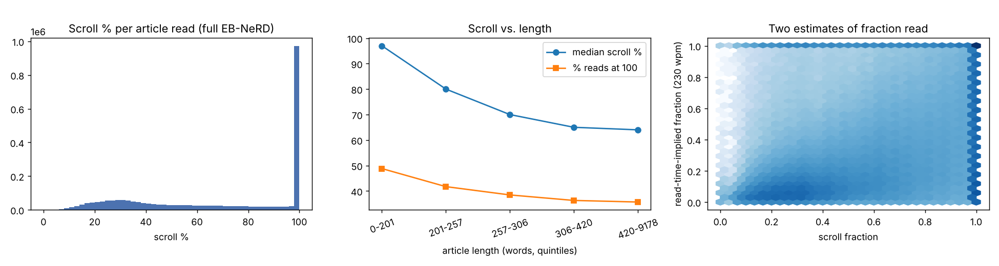
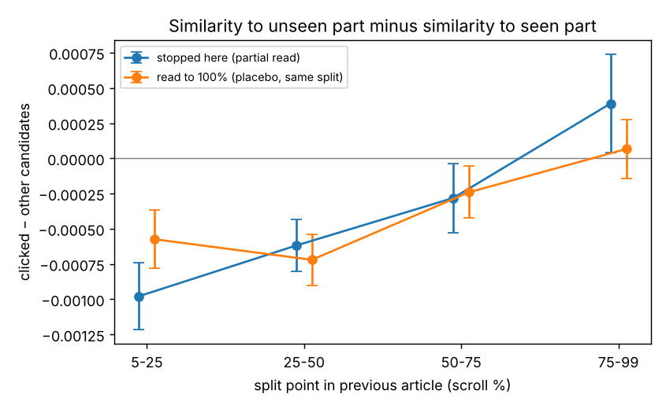

# 01 · Within-article exposure signal

Measures how much information EB-NeRD's per-read `scroll_percentage` and `read_time` carry about the share of an article a reader was exposed to.

## Data
- **EB-NeRD small** (train + validation): 2.46M history reads.
- **EB-NeRD large** (train + validation): 975k users, 131.9M history reads (118.0M with scroll). Shares and the user-variance statistic use all reads; medians and correlations use a 2% random sample (2.36M reads).

Read-time-implied exposure is `read_time × 230 wpm / article word count`, capped at 1.

## Results

| | small | large |
|---|---|---|
| scroll missing | 7.1% | 7.0% |
| reads at 100% scroll | 40.3% | 40.2% |
| reads below 50% scroll | 35.8% | 35.8% |
| Spearman ρ, scroll vs read time | 0.52 | 0.52 |
| Spearman ρ, scroll vs read-time-implied exposure | 0.57 | 0.57 |
| articles with 300+ words at 100% scroll in under 10 s | 4.9% | 4.8% |
| share of scroll variance explained by user (users with ≥20 reads) | 16% | 16% |

**By article length** (EB-NeRD large, word-count quintiles)

| words | median scroll | share at 100% | median read time (s) | median read-time-implied exposure |
|---|---|---|---|---|
| ≤201 | 97 | 48.8% | 14 | 0.39 |
| 202–257 | 80 | 41.7% | 17 | 0.28 |
| 258–306 | 70 | 38.4% | 17 | 0.23 |
| 307–420 | 65 | 36.3% | 19 | 0.20 |
| >420 | 64 | 35.7% | 22 | 0.14 |

**By number of images** (EB-NeRD large)

| images | median scroll | share at 100% |
|---|---|---|
| 0 | 100 | 50.2% |
| 1 | 76 | 40.1% |
| 2–3 | 68 | 37.3% |
| 4+ | 68 | 38.6% |

Summary:
- Item-level histories treat every click as a full read; about a third of reads end before half the page.
- Scroll percentage is systematically higher than read-time-implied exposure and depends on article length and layout, so it is an upper bound on what was on screen rather than a measure of what was read.
- Readers have stable habits, which supports per-user calibration of exposure estimates.

## Next-click test (TF-IDF)
For 117,138 front-page impressions that follow an article read in the same session (previous article ≥6 paragraphs and ≥200 words), the previous article is split at the reader's scroll point into a seen and an unseen part. Each candidate's TF-IDF cosine similarity to the unseen part minus its similarity to the seen part is compared between the clicked article and the other candidates. A placebo uses readers who reached 100% scroll, split at the same points.

| split (scroll %) | partial − placebo | s.e. | Mann–Whitney p |
|---|---|---|---|
| 5–25 | −0.00040 | 0.00016 | 0.002 |
| 25–50 | +0.00010 | 0.00013 | 0.81 |
| 50–75 | −0.00004 | 0.00016 | 0.03 |
| 75–99 | +0.00032 | 0.00021 | 0.65 |

No consistent shift toward the unseen part. See [02_unread_content_test](../02_unread_content_test) for the same test with dense embeddings.

## Files
- `exposure_signal.py DATA_DIR OUT_DIR`: descriptives and the TF-IDF test on EB-NeRD small → `results.json`, `fig1_scroll_profile.png`, `fig2_unseen_pull.png`
- `descriptives_large.py DATA_DIR OUT_DIR`: descriptives on EB-NeRD large → `results_full.json`, `fig1_scroll_profile_full.png`
