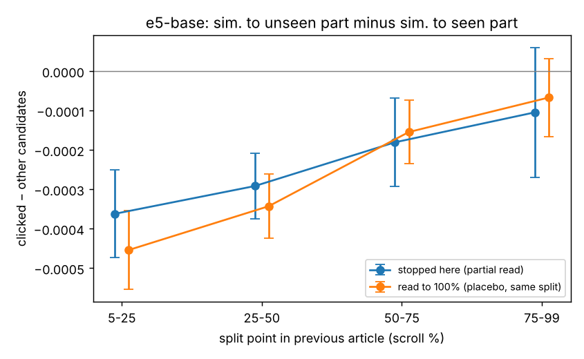

# 02 · Next click and the unread part of the previous article

Tests whether, after a reader stops partway through an article, the next article they click is closer to the part they did not see than to the part they did, relative to the other candidates in the impression.

## Setup
- **Data:** EB-NeRD small (train + validation), same 117,138 follow-up impressions as the TF-IDF test in [01_exposure_signal](../01_exposure_signal).
- **Model:** `intfloat/multilingual-e5-base`, "query: " prefix, max 512 tokens, L2-normalised; 40,276 paragraphs of previous articles and 3,394 candidate articles (title + subtitle + body).
- **Statistic:** cos(candidate, unseen part) − cos(candidate, seen part), clicked minus the mean of the other candidates. Parts are word-weighted means of paragraph embeddings; a best-matching-paragraph variant is also reported in `results.json`.
- **Placebo:** readers who reached 100% scroll, split at the same points.

## Results

| split (scroll %) | partial | placebo | difference (s.e.) | Mann–Whitney p |
|---|---|---|---|---|
| 5–25 | −0.00036 | −0.00045 | +0.00009 (0.00008) | 0.62 |
| 25–50 | −0.00029 | −0.00034 | +0.00005 (0.00006) | 0.55 |
| 50–75 | −0.00018 | −0.00015 | −0.00003 (0.00007) | 0.95 |
| 75–99 | −0.00010 | −0.00007 | −0.00004 (0.00010) | 0.53 |

Partial readers and the placebo do not differ in any bin. Both lean slightly toward the seen (opening) part of the article.

**Topical continuity check** (30k-impression sample): percentile rank of the clicked article among in-view candidates by similarity to the previous article (0.5 = chance):

| representation | rank (s.e.) |
|---|---|
| e5-base | 0.489 (0.002) |
| TF-IDF | 0.472 (0.002) |

The clicked article shares the previous article's category in 23.9% of cases vs 19.6% for other candidates. Next clicks from the front page show little content continuity with the article just read, so this setting has limited power to detect a seen/unseen difference.

## Files
- `unread_content_test.py DATA_DIR OUT_DIR [model]` → `results.json`, `fig_unseen_pull_e5.png`. Set `EMB_CACHE` to reuse embeddings across runs.
